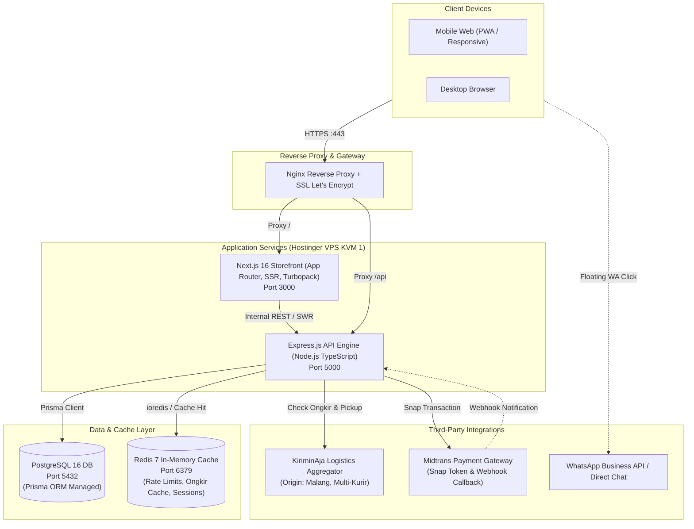
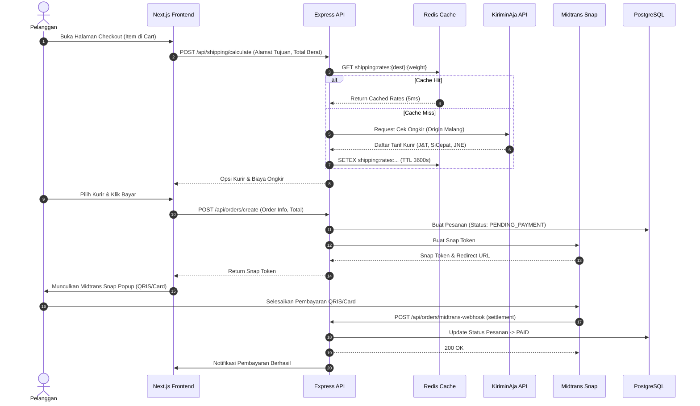

# ARCHITECTURE BLUEPRINT
# BabyShalls E-Commerce Platform

**Versi:** 1.0.0  
**Status:** Approved Architecture Reference  
**Lingkungan Target:** VPS Hostinger KVM 1 (1 vCPU, 4 GB RAM, 50 GB NVMe, Ubuntu 24.04 LTS)

---

## 1. Ikhtisar Arsitektur Sistem (High-Level Architecture)

Arsitektur BabyShalls mengadopsi model **Decoupled Modern Monolith / Two-Tier Modular System** yang memisahkan Storefront (Next.js 16) dengan Core Business Engine (Node.js/Express + Prisma + Redis). 

Pemisahan ini menjamin:
- **SEO & Performa Maksimal**: Next.js Server Components merender halaman katalog produk & artikel dengan cepat.
- **Isolasi Transaksi & Logistik**: Express API menangani webhook Midtrans, kalkulasi KiriminAja, dan otentikasi tanpa membebani thread render frontend.
- **Efisiensi Memori (RAM < 2 GB total)**: Menghindari beban microservice berlebih sehingga sangat stabil di VPS Hostinger 4 GB RAM.



---

## 2. Lapisan Komponen & Tanggung Jawab

### 2.1 Frontend Tier (`frontend/`)
- **Framework**: Next.js 16.4+ (App Router, Turbopack, React 19).
- **Styling**: Tailwind CSS v4 dengan Design Tokens BabyShalls (*Playfair Display*, *Nunito*, Warm Palette).
- **Komponen Modular**:
  - `components/layout`: Header, Navbar, Footer, MobileDrawer, AnnouncementBar, WhatsAppFloating.
  - `components/home`: Hero, ShopByAge, NewArrivals, Hampers, Events, Reviews.
  - `components/product`: ProductCard, AgeBadge, ProductGrid.
  - `components/cart`: CartDrawer (slide-out interaktif dengan kalkulasi berat gram otomatis).
- **State Management**:
  - Client Cart: `CartContext.tsx` dengan sinkronisasi LocalStorage.
  - UI State: Native React Context + Custom Hooks.

### 2.2 Backend Tier (`backend/`)
- **Framework**: Express.js dengan TypeScript ES2022.
- **ORM & Data Access**: Prisma ORM 6.x dengan migrasi otomatis.
- **Cache & Accelerator**: Redis 7 via `ioredis`.
- **Security & Middlewares**:
  - `cors`: Pengaturan domain origin yang diizinkan.
  - `jsonwebtoken` & `bcryptjs`: Otentikasi stateless dengan role `USER` dan `ADMIN`.
  - Rate Limiter berbasis Redis pada rute sensitif (`/api/auth`, `/api/orders`).

### 2.3 Caching Strategy (Redis)
Redis digunakan secara strategis untuk 3 kebutuhan utama:
1. **KiriminAja Shipping Rates Cache (TTL: 60 Menit)**:
   - Ongkir dari Malang ke Kecamatan tujuan dengan berat yang sama bersifat statis dalam rentang jam.
   - Key: `shipping:rates:{destSubdistrictId}:{weightGrams}`.
   - Menghemat kuota request API KiriminAja hingga 85% dan mereduksi latensi checkout dari ~800ms menjadi < 5ms.
2. **Katalog Produk & Kategori Populer (TTL: 15 Menit)**:
   - Key: `catalog:popular` dan `catalog:age:{ageGroup}`.
   - Otomatis di-invalidate saat Admin melakukan perubahan produk.
3. **Idempotency Key Transaksi Midtrans (TTL: 24 Jam)**:
   - Mencegah double-order atau duplikasi pemrosesan webhook notifikasi.

---

## 3. Alur Data Utama (Data Flows)

### 3.1 Alur Transaksi & Checkout (End-to-End)


---

## 4. Topologi Deployment VPS Hostinger (KVM 1)

```text
Hostinger VPS (1 vCPU / 4 GB RAM)
├── System OS: Ubuntu 24.04 LTS
├── Reverse Proxy: Nginx (Port 80/443 dengan SSL Let's Encrypt)
├── Process Manager: PM2 (Daemon clustering & auto-restart on boot)
│   ├── App 1: babyshalls-frontend (Next.js Standalone / Port 3000)
│   └── App 2: babyshalls-backend (Node dist/index.js / Port 5000)
├── Database: PostgreSQL 16 (Port 5432, Unix socket connection)
└── Cache: Redis Server (Port 6379, maxmemory 256MB LRU policy)
```

**Alokasi Penggunaan Memori (Estimasi Running):**
- OS + Nginx: ~350 MB
- PostgreSQL 16: ~400 MB
- Redis Server: ~150 MB
- Node.js Backend API: ~250 MB
- Next.js Server: ~450 MB
- **Total Konsumsi RAM**: ~1.6 GB (Sangat aman dari batas 4 GB RAM, tersisa 2.4 GB headroom).

