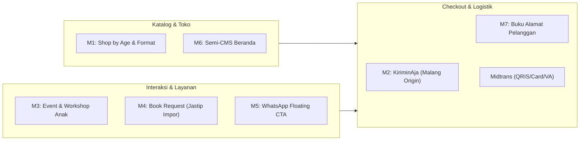

# LAPORAN AUDIT & ROADMAP REFOKUS ARSITEKTUR
## Transformasi Mojo Indah Menjadi E-Commerce BabyShalls
**Target Platform:** Toko Buku Anak Kurasi & Mainan Kayu Edukasi (Malang, Jawa Timur)  
**Dokumen Acuan:** [Proposal Penawaran Pembangunan Website E-Commerce BabyShalls v3](file:///c:/Users/user3/Downloads/Proposal_Website_E-Commerce_BabyShalls_v3.docx)  
**Dokumen Desain:** [DESIGN.md](file:///e:/Project/OWN%20PROJECT/BabyShalls/DESIGN.md) & [html-mockup/index.html](file:///e:/Project/OWN%20PROJECT/BabyShalls/html-mockup/index.html)  
**Status Dokumen:** Master Architectural Blueprint & Action Guide  

---

## 1. Ringkasan Eksekutif & Audit Konsep

### 1.1 Perbandingan Paradigma Sistem

| Parameter | Eksisting (Mojo Indah / Mojo-Grow 2.0) | Target (BabyShalls E-Commerce Fase 1) | Kebutuhan Penyesuaian |
| :--- | :--- | :--- | :--- |
| **Model Bisnis** | Multi-tenant UMKM Marketplace (Banyak toko, banyak mitra penjual). | **Single-Store Boutique E-Commerce** (Toko mandiri milik BabyShalls di Malang). | **Perampingan Drastis**: Hapus model `Tenant`, `TenantStaff`, dan alur multi-seller. |
| **Target Pengguna** | Pelaku UMKM, Mitra Penjual, Kreator, dan Pembeli umum. | Orang tua, pendidik, dan pembeli kado buku/mainan anak. | Re-theming & kurasi UX ke *Warm Cozy Living Storybook*. |
| **Fitur Khusus** | POS Kasir offline, Job portal, LMS Kursus UMKM, Perizinan OSS/NIB/Halal. | **Katalog Usia Anak (Shop by Age)**, **Event/Workshop**, **Book Request**. | Hapus fitur birokrasi & POS offline; bangun modul Event & Permintaan Buku. |
| **Sistem Logistik** | Setting tarif manual per kota (`ShippingProvider`, `ShippingRate`). | **Agregator Otomatis KiriminAja** (Cek ongkir multi-kurir, auto-pickup, pelacakan resi). | Hapus tabel tarif manual, bangun integrasi API KiriminAja dengan *origin* Kota Malang. |
| **Sistem Pembayaran** | Sudah ada integrasi dasar Midtrans Snap. | **Midtrans Payment Gateway** (QRIS, Kartu Kredit, Debit, Virtual Account). | **Pertahankan & rapikan**: Gunakan webhook callback otomatis untuk update pesanan. |
| **Komunikasi User** | Chat realtime WebSocket in-app antar penjual-pembeli. | **Direct Floating WhatsApp Button** & Form Request. | Hapus Socket.io chat room, ganti widget WhatsApp dinamis ke nomor CS. |
| **AI & Background Engine** | Microservice berat (FastAPI + LangChain + ChromaDB + Ollama Qwen 7B/2B). | **Tidak ada kebutuhan AI di Fase 1** (Sesuai Proposal v3). | **Hapus total microservice AI**. Menghemat resource server secara masif. |
| **Infrastruktur Target** | Server lokal / dev berkapasitas besar (RAM 8–16 GB). | **VPS Hostinger KVM 1** (1 vCPU, 4 GB RAM, 50 GB NVMe). | Arsitektur baru dijamin sangat enteng dan stabil di RAM 4 GB. |
| **Peran Pengguna (RBAC)**| 5 Role (`BUYER`, `SELLER`, `CREATOR`, `ADMIN`, `STAFF`). | **2 Role Sahaja**: `USER` (Pelanggan) dan `ADMIN` (BabyShalls). | Sederhanakan enum & middleware otentikasi. |

---

## 2. Fitur & Komponen yang **TETAP HARUS DI-KEEP** (High Reusability)

Komponen-komponen berikut sudah dibangun di Mojo Indah dan memiliki nilai guna tinggi (*reusable*) untuk mempercepat waktu pengembangan BabyShalls hingga 60%:

### 2.1 Backend & Database (Node.js / Express / Prisma)
- **Autentikasi & Akun (`auth.routes.ts`)**: Registrasi, login, hashing kata sandi (Bcrypt), verifikasi JWT, proteksi rute (`auth.middleware.ts`), dan pengelolaan profil dasar.
- **Katalog Produk & Media Upload (`product.routes.ts`, `upload.routes.ts`)**: CRUD produk, galeri gambar (Cloudinary/lokal), nama, harga, stok, berat produk (gram), deskripsi.
- **Keranjang Belanja & Favorit (`cart.routes.ts`, `wishlist.routes.ts`)**: Manajemen cart item per user, sinkronisasi kuantitas, subtotal, dan daftar wishlist.
- **Modul Pembayaran Midtrans (`backend/src/lib/midtrans.ts`, `midtrans.routes.ts`)**: Snap token generation dan webhook notification callback handler.
- **Manajemen Pesanan (`order.routes.ts`)**: Relasi `Order` dan `OrderItem`, penomoran faktur/order number, status pembayaran, serta alur status pesanan.

### 2.2 Frontend (React + Vite + Zustand)
- **State Management (`frontend/src/store/`)**:
  - `authStore.ts`: Penyimpanan token JWT & sesi login.
  - `cartStore.ts`: Keranjang belanja lokal & sinkronisasi database.
  - `wishlistStore.ts`: State favorit produk.
- **Halaman Alur Transaksi**:
  - `Cart.tsx`: Halaman keranjang belanja (tinggal disesuaikan warna & tema).
  - `Checkout.tsx`: Form checkout (tinggal dihubungkan ke API KiriminAja & Midtrans).
  - `OrderDetail.tsx` & `MyOrders.tsx`: Riwayat pesanan & tampilan resi pengiriman.
  - `Login.tsx` & `Register.tsx`: Alur otentikasi siap pakai.
- **Admin UI Components**: Tabel data, modal dialog, formulir upload produk, dan badge status transaksi.

---

## 3. Fitur, Halaman & Service yang **HARUS DIHAPUS / DEPRECATED**

Fitur-fitur ini berada di luar ruang lingkup BabyShalls Fase 1 dan harus dibuang demi kestabilan, kecepatan, dan kesederhanaan kode:

```text
[HAPUS] 1. Seluruh Microservice AI (FastAPI, LangChain, ChromaDB, Ollama, Qwen models)
[HAPUS] 2. Voice AI Assistant (MojoVoiceButton.tsx, gemini-stt.ts, voice.routes.ts)
[HAPUS] 3. Sistem POS Kasir & Inventaris Gudang Offline (POSPage, CashRegister, StockCard)
[HAPUS] 4. Multi-Tenancy Engine (Tenant, TenantStaff, StorePage, MerchantOnboarding)
[HAPUS] 5. Modul LMS / Kursus UMKM (Courses.tsx, CourseDetail.tsx, course.routes.ts)
[HAPUS] 6. Modul Lowongan Kerja (Jobs.tsx, job.routes.ts, JobPosting, JobApplication)
[HAPUS] 7. Modul Legalitas & Izin Usaha (license.routes.ts, oss-permit.routes.ts, NIB/KBLI)
[HAPUS] 8. In-App Realtime Socket Chat (chat.routes.ts, ChatPage.tsx, RealtimeChatWidget.tsx)
[HAPUS] 9. Fitur Skor Kredit & Pinjaman UMKM (LoanSimulator.tsx, MojoScore.tsx)
[HAPUS] 10. Pengaturan Tarif Kurir Manual (ShippingProvider & ShippingRate statis)
```

### Rincian Berkas yang Aman Dihapus:
- **Root Directory**:
  - `mojoindah/ai-service/` (Semua file Python, model, LangChain)
  - `mojoindah/chroma_db/` (Chroma database SQLite & binary)
  - `mojoindah/tests/` (Test skrip lama)
- **Backend (`mojoindah/backend/src/`)**:
  - `routes/ai.routes.ts`
  - `routes/course.routes.ts`
  - `routes/job.routes.ts`
  - `routes/license.routes.ts`
  - `routes/oss-permit.routes.ts`
  - `routes/pos.routes.ts`
  - `routes/voice.routes.ts`
  - `routes/chat.routes.ts`
  - `routes/mojo-rescue.routes.ts`
  - `routes/store.routes.ts`
  - `socket/chatHandler.ts`
  - `utils/rag-helper.ts`
  - `utils/voice/` (Semua file: `gemini-stt.ts`, `intent-classifier.ts`, `lexicon.ts`, dll.)
  - `lib/mojo-rescue-scheduler.ts`
- **Frontend (`mojoindah/frontend/src/`)**:
  - `pages/POS/` (Seluruh folder kasir)
  - `pages/Courses.tsx` & `pages/CourseDetail.tsx`
  - `pages/Jobs.tsx` & `pages/MyApplications.tsx`
  - `pages/ChatPage.tsx`
  - `pages/StorePage.tsx`
  - `pages/MojoScore.tsx`
  - `pages/onboarding/` (`CreatorOnboarding.tsx`, `MerchantOnboarding.tsx`)
  - `components/mojo/` (`LoanSimulator.tsx`, `MojoScoreGauge.tsx`)
  - `components/pos/` (Seluruh komponen POS)
  - `components/onboarding/`
  - `components/common/AIChatbotWidget.tsx`
  - `components/common/MojoVoiceButton.tsx`
  - `components/common/VoiceWaveform.tsx`
  - `components/common/RealtimeChatWidget.tsx`
  - `components/common/BarcodeModal.tsx`
  - `store/posStore.ts`
  - `store/chatNotificationStore.ts`

---

## 4. Modul Tambahan Baru yang Diperlukan BabyShalls

Sesuai dokumen Proposal v3 Bagian 5 & 6, berikut 7 modul baru yang wajib dibangun:



### 4.1 Modul 1: Katalog Khusus Anak (**Shop by Age & Category**)
- **Kategori Kelompok Usia**:
  - `Newborn+` (0 – 1 tahun)
  - `Ages 1-3` (1 – 3 tahun)
  - `Ages 3+` (3 – 5 tahun)
  - `Ages 6+` (6+ tahun)
- **Tipe Format Produk**: *Board Books*, *Picture Books*, *Sound/Sensory Books*, *Wooden Toys*, *Gift Hampers*.
- **Data Produk**: Berat dalam satuan gram (krusial untuk kalkulasi kurir KiriminAja), badge usia, status stok.

### 4.2 Modul 2: Integrasi Agregator Kurir KiriminAja (`backend/src/lib/kiriminaja.ts`)
- **Origin Pengiriman**: Terkunci di **Kota Malang, Jawa Timur** (Lokasi fisik BabyShalls di Jl. Cempaka No. 12, Malang).
- **Cek Ongkir Real-time (`POST /api/shipping/calculate`)**:
  - **Payload Input**:
    ```json
    {
      "destination_subdistrict_id": 1234,
      "weight_grams": 750,
      "couriers": ["jne", "jnt", "sicepat", "anteraja"]
    }
    ```
  - **Output Response**:
    ```json
    [
      { "courier": "JNE", "service": "REG", "cost": 18000, "etd": "2-3 hari" },
      { "courier": "J&T", "service": "EZ", "cost": 17000, "etd": "1-2 hari" }
    ]
    ```
- **Request Pickup Otomatis (`POST /api/admin/orders/:id/pickup`)**:
  - Admin menekan tombol *"Request Pickup"* dari dashboard pesanan saat paket siap.
  - API KiriminAja langsung menerbitkan Nomor Resi (*Waybill Number*) otomatis.
- **Pelacakan Resi**: Status pengiriman terupdate dan dapat dilacak pelanggan di halaman *Riwayat Pesanan*.

### 4.3 Modul 3: Workshop & Event Anak (Fase 1 Ringkas)
- **Public Endpoints**:
  - `GET /api/events` (Daftar workshop aktif)
  - `GET /api/events/:slug` (Detail & sisa kuota)
  - `POST /api/events/:id/register` (Pendaftaran peserta):
    ```json
    {
      "participantName": "Bunda Sarah",
      "childName": "Kenzo",
      "childAge": "3 Tahun",
      "whatsappNumber": "08123456789",
      "notes": "Anak aktif dan suka mewarnai"
    }
    ```
- **Admin Dashboard**:
  - Kelola data workshop (kuota, jadwal, lokasi, foto).
  - Rekap nama anak & kontak WA orang tua pendaftar (bisa diunduh).

### 4.4 Modul 4: Layanan Permintaan Buku (**Book Request / Jastip Impor**)
- **User Form (`POST /api/book-requests`)**:
  ```json
  {
    "title": "The Very Hungry Caterpillar (Hardcover)",
    "authorPublisher": "Eric Carle / Penguin",
    "notes": "Tolong carikan edisi pop-up book bahasa Inggris",
    "whatsappNumber": "08123456789"
  }
  ```
- **Admin Flow (`GET /api/admin/book-requests`, `PATCH /api/admin/book-requests/:id`)**:
  - Status kerja: `PENDING` $\rightarrow$ `MENCARI_STOK` $\rightarrow$ `DIKUOTASI` $\rightarrow$ `DIPESAN` $\rightarrow$ `SELESAI` / `BATAL`.
  - Admin mengisi catatan internal dan estimasi harga untuk follow-up via WhatsApp ke pelanggan.

### 4.5 Modul 5: Semi-CMS Konten Halaman Utama
Pengaturan teks dan visual yang dapat diubah admin lewat dashboard tanpa menyentuh kode:
- Running banner promo atas (*"Free gift wrapping for hampers"*).
- Banner Hero (Headline, sub-headline, foto anak membaca, tombol CTA).
- Banner promosi Gift Hampers.
- Testimoni kurasi (rating Shopee 5.0 bintang & 359 ulasan pelanggan).

### 4.6 Modul 6: WhatsApp Direct Button
- Tombol mengambang (*floating pill*) di kanan bawah layar.
- Otomatis mengisi salam dinamis (*pre-filled text*), misal: *"Halo Admin BabyShalls, saya ingin bertanya tentang produk [Nama Produk]..."*.

### 4.7 Modul 7: Multi-Address Pelanggan
- Pelanggan dapat menyimpan beberapa alamat (Rumah, Kantor, Alamat Kado/Penerima Hampers).
- Integrasi data Kota & ID Kecamatan yang kompatibel dengan KiriminAja.

---

## 5. Rekomendasi Skema Database Prisma Ramping (`schema.prisma`)

Skema Prisma bersih ini merampingkan model 1.000 baris Mojo Indah menjadi ~130 baris:

```prisma
datasource db {
  provider = "postgresql" // atau mysql sesuai preferensi deployment
  url      = env("DATABASE_URL")
}

generator client {
  provider = "prisma-client-js"
}

enum Role {
  USER
  ADMIN
}

enum AgeGroup {
  NEWBORN_PLUS
  AGES_1_3
  AGES_3_PLUS
  AGES_6_PLUS
  ALL_AGES
}

enum OrderStatus {
  PENDING_PAYMENT
  PAID
  PROCESSING
  SHIPPED
  COMPLETED
  CANCELLED
}

model User {
  id           String              @id @default(uuid())
  email        String              @unique
  passwordHash String
  name         String
  phone        String?
  role         Role                @default(USER)
  addresses    Address[]
  orders       Order[]
  eventRegs    EventRegistration[]
  bookRequests BookRequest[]
  cartItems    CartItem[]
  wishlists    Wishlist[]
  createdAt    DateTime            @default(now())
}

model Address {
  id            String   @id @default(uuid())
  userId        String
  user          User     @relation(fields: [userId], references: [id], onDelete: Cascade)
  label         String   @default("Rumah") // Rumah, Kantor, Kado
  receiverName  String
  receiverPhone String
  streetAddress String
  city          String
  subdistrict   String
  subdistrictId Int?     // ID Kecamatan KiriminAja
  postalCode    String
  isDefault     Boolean  @default(false)
}

model Product {
  id           String      @id @default(uuid())
  name         String
  slug         String      @unique
  description  String      @db.Text
  price        Decimal     @db.Decimal(12, 2)
  stock        Int         @default(0)
  weight       Int         @default(300) // Gram untuk KiriminAja
  ageGroup     AgeGroup    @default(ALL_AGES)
  category     String      // Books, Wooden Toys, Hampers
  images       Json        // Array URL foto produk
  isFeatured   Boolean     @default(false)
  isNewArrival Boolean     @default(false)
  cartItems    CartItem[]
  wishlists    Wishlist[]
  orderItems   OrderItem[]
  createdAt    DateTime    @default(now())
  updatedAt    DateTime    @updatedAt
}

model CartItem {
  id        String   @id @default(uuid())
  userId    String
  user      User     @relation(fields: [userId], references: [id], onDelete: Cascade)
  productId String
  product   Product  @relation(fields: [productId], references: [id], onDelete: Cascade)
  quantity  Int      @default(1)
  createdAt DateTime @default(now())

  @@unique([userId, productId])
}

model Wishlist {
  id        String   @id @default(uuid())
  userId    String
  user      User     @relation(fields: [userId], references: [id], onDelete: Cascade)
  productId String
  product   Product  @relation(fields: [productId], references: [id], onDelete: Cascade)

  @@unique([userId, productId])
}

model Order {
  id              String      @id @default(uuid())
  orderNumber     String      @unique
  userId          String
  user            User        @relation(fields: [userId], references: [id])
  totalAmount     Decimal     @db.Decimal(12, 2)
  shippingCost    Decimal     @db.Decimal(12, 2)
  grandTotal      Decimal     @db.Decimal(12, 2)
  status          OrderStatus @default(PENDING_PAYMENT)

  // Midtrans
  snapToken       String?
  paymentMethod   String?
  paidAt          DateTime?

  // KiriminAja
  courierCode     String?     // jne, jnt, sicepat
  courierService  String?     // REG, OKE
  waybillNumber   String?     // Nomor Resi
  shippingAddress Json        // Snapshot alamat penerima

  items           OrderItem[]
  createdAt       DateTime    @default(now())
  updatedAt       DateTime    @updatedAt
}

model OrderItem {
  id        String   @id @default(uuid())
  orderId   String
  order     Order    @relation(fields: [orderId], references: [id], onDelete: Cascade)
  productId String
  product   Product  @relation(fields: [productId], references: [id])
  price     Decimal  @db.Decimal(12, 2)
  quantity  Int      @default(1)
}

model Event {
  id            String              @id @default(uuid())
  title         String
  slug          String              @unique
  description   String              @db.Text
  bannerImage   String
  eventDate     DateTime
  timeString    String              // "10:00 - 12:00 WIB"
  location      String              // "Offline Store Malang"
  price         Decimal             @default(0) @db.Decimal(12, 2)
  quota         Int                 @default(20)
  registrations EventRegistration[]
  createdAt     DateTime            @default(now())
}

model EventRegistration {
  id              String   @id @default(uuid())
  eventId         String
  event           Event    @relation(fields: [eventId], references: [id], onDelete: Cascade)
  userId          String?
  user            User?    @relation(fields: [userId], references: [id])
  participantName String
  childName       String
  childAge        String
  whatsappNumber  String
  status          String   @default("REGISTERED") // REGISTERED, CONFIRMED, ATTENDED
  createdAt       DateTime @default(now())
}

model BookRequest {
  id              String   @id @default(uuid())
  userId          String?
  user            User?    @relation(fields: [userId], references: [id])
  title           String
  authorPublisher String?
  notes           String?  @db.Text
  whatsappNumber  String
  status          String   @default("PENDING") // PENDING, SEARCHING, QUOTED, ORDERED, FULFILLED
  adminNotes      String?  @db.Text
  createdAt       DateTime @default(now())
}

model SiteContent {
  id              String   @id @default("singleton")
  announcementBar String?  @default("Free gift wrapping for hampers")
  heroHeading     String?  @default("Find the right book for your little one")
  heroSubheading  String?  @default("Curated children's books and educational toys")
  heroImageUrl    String?
  hamperBannerUrl String?
  whatsappNumber  String?  @default("628123456789")
  updatedAt       DateTime @updatedAt
}
```

---

## 6. Setup Design System & Theme BabyShalls (`tailwind.config.cjs`)

```javascript
/** @type {import('tailwindcss').Config} */
module.exports = {
  content: ["./index.html", "./src/**/*.{js,ts,jsx,tsx}"],
  theme: {
    extend: {
      colors: {
        cream: {
          light: '#FFF8EF', // Latar belakang utama
          DEFAULT: '#FCF6EC', // Kartu
          offwhite: '#FFF9F0',
        },
        peach: {
          light: '#FFE4D0',
          DEFAULT: '#FCE0D4',
        },
        salmon: '#F6B79B',
        terracotta: {
          DEFAULT: '#DA7A5B', // Tombol CTA Utama
          dark: '#C46749',
        },
        mustard: {
          DEFAULT: '#F6C95E',
          light: '#FDF3D6',
        },
        sage: {
          DEFAULT: '#DCE6C6',
          light: '#EBF2E0',
        },
        leaf: {
          DEFAULT: '#A7C48A',
          dark: '#709154',
        },
        warmbrown: {
          DEFAULT: '#6B3F2A', // Teks isi
          dark: '#502E1E',   // Judul utama
          light: '#CBA989',
        },
      },
      fontFamily: {
        serif: ['"Playfair Display"', 'Georgia', 'serif'],
        sans: ['Nunito', 'sans-serif'],
      },
      borderRadius: {
        'card': '20px',
        'pill': '9999px',
      },
    },
  },
  plugins: [],
}
```

---

## 7. Struktur Halaman Baru Storefront (`frontend/src/App.tsx`)

```text
/                              -> Beranda (Hero, Shop by Age, New Arrivals, Hampers, Event, Testimoni)
/catalog                       -> Katalog Lengkap (Filter: Usia Anak, Kategori, Search, Urutan)
/product/:slug                 -> Detail Produk (Galeri, Badge Usia, Berat Gram, Deskripsi, Tombol Cart)
/cart                          -> Keranjang Belanja
/checkout                      -> Checkout (Alamat, Cek Ongkir KiriminAja, Pembayaran Midtrans Snap)
/events                        -> Daftar Workshop & Kegiatan Anak
/events/:slug                  -> Detail Workshop & Formulir Pendaftaran Peserta
/request-book                  -> Formulir Permintaan / Jastip Buku Impor
/account/profile               -> Pengaturan Profil & Buku Alamat Penerima
/account/orders                -> Riwayat Pesanan & Lacak Resi Pengiriman
/admin/dashboard               -> Rekap Penjualan, Pendapatan, Pesanan Baru, Leads Event & Buku
/admin/products                -> Manajemen Produk & Stok
/admin/orders                  -> Manajemen Pesanan & Request Pickup Kurir
/admin/events                  -> Pengelolaan Workshop & Data Peserta
/admin/book-requests           -> Pengelolaan Permintaan Buku & Catatan Follow-up
/admin/site-content            -> Semi-CMS (Ubah teks banner atas, banner promo hampers, hero)
```

---

## 8. Roadmap Eksekusi Refactoring (Sprint Plan 4 Minggu)

```text
Minggu 1: Pembersihan & Fondasi Data
  ├── Hapus ai-service, chroma_db, modul POS, Jobs, LMS, & Multi-tenant.
  ├── Terapkan skema Prisma baru & jalankan migrasi database.
  ├── Sederhanakan middleware auth (hanya role ADMIN & USER).
  └── Konfigurasi tema Tailwind & import Google Fonts (Playfair Display + Nunito).

Minggu 2: Toko, Katalog & Semi-CMS
  ├── Pasang mockup index.html ke komponen React beranda BabyShalls.
  ├── Bangun halaman katalog dengan filter "Shop by Age" & Kategori.
  ├── Halaman detail produk (badge usia, berat gram, tombol add to cart).
  └── CRUD Produk & Semi-CMS (kelola banner & teks beranda) di Admin.

Minggu 3: Integrasi Pengiriman & Pembayaran
  ├── Bangun service KiriminAja (cek ongkir multi-kurir & request pickup).
  ├── Hubungkan form checkout ke pilihan kurir KiriminAja & Midtrans Snap.
  ├── Rapikan webhook handler Midtrans untuk update pesanan otomatis.
  └── Tampilkan pelacakan resi di halaman Riwayat Pesanan pelanggan.

Minggu 4: Event, Book Request & Peluncuran
  ├── Halaman Event & formulir pendaftaran workshop anak.
  ├── Halaman & formulir Book Request (jastip buku impor).
  ├── Dashboard rekap admin (pesanan, leads workshop, book requests).
  └── Pengujian checkout end-to-end & persiapan deploy ke VPS Hostinger KVM 1.
```

---
*Laporan audit dan rencana kerja ini disiapkan untuk dijadikan panduan langsung pengerjaan kode BabyShalls.*
