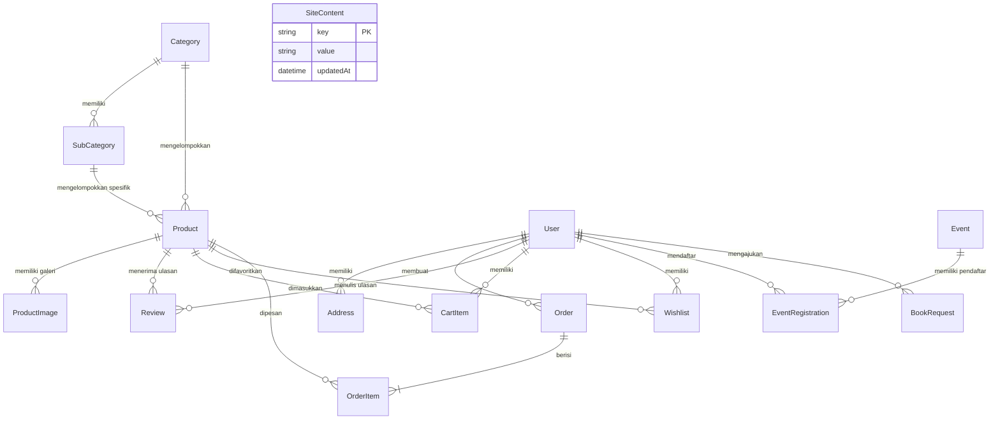

# DATABASE SCHEMA & DATA DICTIONARY
# BabyShalls PostgreSQL Architecture

**Engine:** PostgreSQL 16  
**ORM Tooling:** Prisma ORM 6.x  
**File Skema:** `backend/prisma/schema.prisma`

---

## 1. Diagram Relasi Entitas (ERD)

---

## 2. Kamus Data (Data Dictionary)

### 2.1 Tabel `User`
| Kolom | Tipe Data | Keterangan |
| :--- | :--- | :--- |
| `id` | UUID (PK) | Identifier unik user |
| `email` | String (Unique) | Email login |
| `passwordHash` | String | Hash Bcrypt (min 10 salt rounds) |
| `name` | String | Nama lengkap |
| `phone` | String (Nullable) | Nomor telepon/WhatsApp |
| `role` | Enum (`USER`, `ADMIN`) | Default `USER` |
| `createdAt` | DateTime | Timestamp registrasi |

### 2.2 Tabel `Address`
| Kolom | Tipe Data | Keterangan |
| :--- | :--- | :--- |
| `id` | UUID (PK) | Identifier alamat |
| `userId` | UUID (FK -> User) | Pemilik alamat |
| `label` | String | Contoh: "Rumah", "Kantor", "Kado" |
| `receiverName` | String | Nama penerima paket |
| `receiverPhone` | String | Nomor telepon penerima |
| `streetAddress` | String | Alamat jalan & nomor |
| `city` | String | Kota / Kabupaten tujuan |
| `subdistrict` | String | Nama Kecamatan |
| `subdistrictId` | Int (Nullable) | **ID Kecamatan KiriminAja** untuk cek ongkir |
| `postalCode` | String | Kode pos |
| `isDefault` | Boolean | Status alamat utama |

### 2.3 Tabel `Category` & `SubCategory`
- **`Category`**: Kelompok katalog utama (`Books`, `Wooden Toys`, `Gift Hampers`, `Sound & Sensory`).
  - Kolom: `id` (UUID), `name`, `slug` (unique), `description`, `badge`, `sortOrder`, `createdAt`, `updatedAt`.
- **`SubCategory`**: Sub-kelompok katalog spesifik (`Board Books`, `Picture Books`, `Balok Kayu`, `Puzzle Kayu`, `Sensory Play`).
  - Kolom: `id` (UUID), `categoryId` (FK), `name`, `slug`, `description`, `badge`, `sortOrder`, `createdAt`, `updatedAt`.

### 2.4 Tabel `Product`
| Kolom | Tipe Data | Keterangan |
| :--- | :--- | :--- |
| `id` | UUID (PK) | Identifier produk |
| `name` | String | Nama produk buku/mainan |
| `slug` | String (Unique) | URL SEO friendly |
| `description` | Text | Deskripsi kurasi |
| `price` | Decimal(12,2) | Harga jual IDR |
| `originalPrice` | Decimal(12,2) (Nullable) | Harga coret / sebelum diskon |
| `authorOrBrand` | String (Nullable) | Penulis buku atau merek mainan kurasi |
| `stock` | Int | Sisa stok barang |
| `weight` | Int | **Berat dalam gram** (krusial untuk KiriminAja) |
| `ageGroup` | Enum | `NEWBORN_PLUS`, `AGES_1_3`, `AGES_3_PLUS`, `AGES_6_PLUS`, `ALL_AGES` |
| `category` | String | Slug / teks kategori utama |
| `subCategory` | String (Nullable) | Slug / teks sub-kategori spesifik |
| `images` | JSON Array | Fallback list URL foto |
| `rating` | Decimal(3,1) | Nilai rata-rata ulasan (default 5.0) |
| `reviewsCount` | Int | Jumlah ulasan pembeli (default 0) |
| `isFeatured` | Boolean | Tampil di beranda rekomendasi |
| `isNewArrival` | Boolean | Badge New Arrival |
| `isBestSeller` | Boolean | Badge Best Seller |
| `features` | JSON Array (Nullable) | List keunggulan produk (bullet points) |
| `categoryId` | UUID (Nullable, FK) | Relasi ke `Category` |
| `subCategoryId` | UUID (Nullable, FK) | Relasi ke `SubCategory` |

### 2.5 Tabel `ProductImage` (Multi-Image Gallery)
| Kolom | Tipe Data | Keterangan |
| :--- | :--- | :--- |
| `id` | UUID (PK) | Identifier gambar |
| `productId` | UUID (FK -> Product) | Relasi produk |
| `url` | String | URL file gambar (WebP / CDN) |
| `caption` | String (Nullable) | Keterangan / variasi gambar |
| `sortOrder` | Int | Urutan tampilan di galeri foto |
| `createdAt` | DateTime | Timestamp upload |

### 2.6 Tabel `Review` (Ulasan Pelanggan)
| Kolom | Tipe Data | Keterangan |
| :--- | :--- | :--- |
| `id` | UUID (PK) | Identifier ulasan |
| `productId` | UUID (FK -> Product) | Produk yang diulas |
| `userId` | UUID (Nullable, FK -> User)| User pembeli jika login |
| `userName` | String | Nama reviewer / Ibu & Ayah |
| `location` | String (Nullable) | Lokasi pembeli (e.g. "Malang, Jawa Timur") |
| `rating` | Int | Nilai bintang (1 - 5) |
| `comment` | Text | Isi review kepuasan produk |
| `variantInfo` | String (Nullable) | Catatan varian yang dibeli |
| `helpfulCount`| Int | Jumlah pembeli lain yang merasa ulasan terbantu |
| `createdAt` | DateTime | Tanggal ulasan |

### 2.7 Tabel `Order` & `OrderItem`
- **`Order`**: Menyimpan nomor order `BS-YYYYMMDD-XXX`, total belanja, biaya ongkir KiriminAja, status pembayaran (`PENDING_PAYMENT`, `PAID`, `PROCESSING`, `SHIPPED`, `COMPLETED`, `CANCELLED`), token Midtrans Snap, nomor resi pengiriman (*waybill number*), dan snapshot JSON alamat pengiriman.
- **`OrderItem`**: Baris rincian item, kuantitas, dan harga satuan saat transaksi terjadi.

### 2.8 Tabel `Event` & `EventRegistration`
- **`Event`**: Jadwal workshop anak di toko Malang (judul, waktu, lokasi, harga, kuota).
- **`EventRegistration`**: Data anak pendaftar (nama anak, usia anak, nama orang tua, nomor WA, status).

### 2.9 Tabel `BookRequest`
- Menyimpan formulir titip/jastip buku impor dari pelanggan (judul, penulis, kontak WA, catatan, status, dan catatan internal admin).

### 2.10 Tabel `SiteContent`
- Menyimpan konfigurasi teks Semi-CMS beranda secara dinamis dengan format Key-Value.
