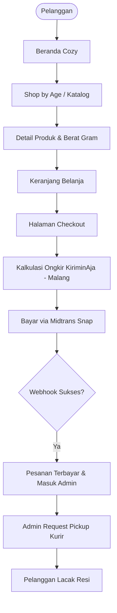

# PRODUCT REQUIREMENTS DOCUMENT (PRD)
# E-COMMERCE PLATFORM BABYSHALLS

**Versi Dokumen:** 2.0.0  
**Tanggal Diperbarui:** 14 November 2026  
**Status:** Updated to Current Architecture & Scope  
**Disusun Berdasarkan:** 
- Proposal Penawaran Pembangunan Website E-Commerce BabyShalls v3 (8 November 2026)
- Laporan Audit & Roadmap Refokus Arsitektur BabyShalls
- BabyShalls Fresh Minimalist Boutique Design System (`DESIGN.md` v4.0)
- Implementasi Frontend Next.js 16 (`frontend/src`) & Skema Prisma (`backend/prisma/schema.prisma`)

---

## 1. Ringkasan Eksekutif & Visi Produk

### 1.1 Visi Produk
BabyShalls adalah butik toko buku anak kurasi (*curated children's bookstore*) dan mainan edukasi kayu (*educational wooden toys*) yang berbasis di Kota Malang, Jawa Timur. Setelah lebih dari 7 tahun sukses melayani ribuan pelanggan via marketplace (Shopee rating 5.0, 359 penilaian) dan komunitas Instagram (@babyshalls, 21,3k followers), BabyShalls beralih memiliki kanal digital mandiri (*direct-to-consumer/D2C*).

Website E-Commerce BabyShalls dibangun sebagai platform terpadu satu pintu (*single-door hub*) yang mengintegrasikan:
1. **Penjualan Katalog Produk Mandiri** dengan pembayaran online otomatis (Midtrans).
2. **Kalkulasi Logistik Multi-Kurir Otomatis** dengan titik keberangkatan terverifikasi dari Kota Malang (KiriminAja).
3. **Pendaftaran Workshop & Event Edukasi Anak** (Storytelling session, Market Day).
4. **Layanan Khusus Permintaan Buku Impor (*Book Request / Jastip*)**.
5. **Dashboard Operasional Mandiri (Semi-CMS)** untuk manajemen produk, pesanan, banner promo, dan leads tanpa sentuh kode.

### 1.2 Target Sukses Fase 1
- Peluncuran platform stabil dalam **4 minggu kerja**.
- Checkout mulus dengan konfirmasi pembayaran seketika tanpa cek mutasi manual.
- Tampilan responsif cepat dengan konsep estetika *Warm Cozy Living Storybook*.
- Biaya operasional hemat & efisien, stabil di server spesifikasi terjangkau (VPS Hostinger KVM 1: 1 vCPU, 4 GB RAM).

---

## 2. User Persona & Target Audiens

| Persona | Profil & Karakteristik | Kebutuhan Utama | Touchpoint di Website |
| :--- | :--- | :--- | :--- |
| **Bunda Sarah (28–36 th)** | Ibu muda modern, peduli stimulasi literasi & *sensory play* anak usia 0–5 tahun. | Mencari buku yang pas untuk usia anaknya tanpa bingung menyaring ribuan judul acak. | Filter **Shop by Age**, rekomendasi New Arrivals, detail bobot buku. |
| **Tante Lina (25–32 th)** | Kerabat / teman yang mencari kado ulang tahun atau kelahiran bayi (*gift hunter*). | Opsi kado siap kirim, kemasan cantik (*free gift wrapping*), kartu ucapan. | Bagian **Gift Hampers**, opsi alamat pengiriman fleksibel. |
| **Ibu Guru Maya (30–45 th)** | Pendidik PAUD / TK atau pegiat *homeschooling*. | Mencari buku referensi impor langka dan ingin mendaftarkan anak didiknya ke workshop edukatif. | Modul **Book Request**, katalog **Workshops & Events**. |
| **Admin BabyShalls (Malang)** | Tim operasional toko fisik & online BabyShalls. | Memproses pesanan cepat, request pickup kurir dalam 1 klik, update banner promo mingguan. | **Dashboard Admin**, panel Semi-CMS, manajemen pesanan. |

---

## 3. Ruang Lingkup Proyek (Scope of Work)

### 3.1 In-Scope (Fase 1)
- **Modul M1: Toko & Pembayaran**
  - Katalog buku dan mainan kayu bergaya Shopee/Tokopedia dengan filter usia (*Newborn+*, *1-3*, *3+*, *6+*), kategori, subkategori dinamis, rentang harga, pencarian teks, dan pengurutan harga/terbaru.
  - Halaman detail produk (galeri multi-foto, badge usia, berat gram, deskripsi, stok real-time, ulasan terverifikasi *read-only*, produk terkait).
  - Halaman **Wishlist** (`/wishlist`) terintegrasi pada header dan kartu produk.
  - Keranjang belanja (slide-out cart drawer) dengan state persistensi lokal/server.
  - Multi-address per user, input **Kupon / Voucher Promo**, dan integrasi Midtrans Snap (QRIS, Kartu Kredit, Debit Online) dengan webhook otomatis.
- **Modul M2: Pengiriman Terintegrasi (KiriminAja)**
  - Cek ongkir multi-kurir real-time dari origin tetap: **Kota Malang, Jawa Timur**.
  - Pilihan layanan kurir (Reguler / Express) dengan biaya transparan.
  - Pembuatan pickup request dari Admin, **cetak resi pengiriman format PDF resmi**, dan pelacakan lokasi/status resi di detail pesanan pelanggan.
- **Modul M3: Manajemen Akun & Pengguna**
  - Sistem peran 2 level: `USER` (Pelanggan) dan `ADMIN` (BabyShalls) — tanpa sistem grosir/reseller (fokus B2C retail & gift).
  - Layout pengelolaan akun bergaya Shopee (`/account`): Profil Saya, Buku Alamat, Riwayat & Detail Pesanan (lacak lokasi paket, cetak resi PDF, dan **kirim komentar/ulasan produk hanya dari detail pesanan**), Tiket Event & QR Check-in, serta Voucher Saya.
- **Modul M4: Event & Workshop**
  - Daftar workshop, detail acara (tanggal, lokasi, kuota, instruktur).
  - Formulir pendaftaran peserta, dukungan tiket berbayar Midtrans, dan E-Ticket QR Check-in.
- **Modul M5: Layanan Book Request (Jastip Buku Impor)**
  - Formulir permintaan buku minimalis dan bersih (judul, penulis, kontak WA/email, catatan, opsional referensi foto).
  - Manajemen status permintaan & catatan penawaran di dashboard admin.
- **Modul M6: Admin Dashboard & Semi-CMS**
  - CRUD produk & kelola stok, manajemen pesanan & status logistik, manajemen kupon/voucher promo.
  - Semi-CMS: ganti teks banner announcement, banner hero, dan promo hampers tanpa sentuh kode.
  - Rekap statistik ringkas (omzet, pesanan perlu dikirim, permintaan Book Request, voucher terpakai).
- **Floating Contact CTA**: Tombol WhatsApp mengambang dinamis ke nomor CS Malang.

### 3.2 Out-of-Scope (Dialokasikan ke Fase 2)
- Tiket QR check-in peserta workshop di lokasi fisik.
- Kalender interaktif event.
- Sinkronisasi stok 2 arah otomatis dengan akun Shopee (stok website dikelola independen di fase 1).
- Fitur multi-tenant / multi-seller marketplace (ditiadakan demi single boutique).
- Aplikasi mobile native Android/iOS (fase 1 difokuskan pada Progressive Web App / Mobile Responsive Web).

---

## 4. Persyaratan Fungsional Detail (Functional Specs)



### 4.1 Modul M1: Toko & Transaksi
- **Filter Kelompok Usia Wajib**:
  1. `Newborn+` (0 – 1 tahun) — *Board books, high-contrast, sensory play*.
  2. `Ages 1-3` (1 – 3 tahun) — *Toddler picture books, wooden stackers*.
  3. `Ages 3+` (3 – 5 tahun) — *Storybooks, interactive pretend play*.
  4. `Ages 6+` (6+ tahun) — *Early chapter books, STEM wooden puzzles*.
- **Parameter Produk Wajib**: `id`, `slug`, `title`, `price`, `salePrice`, `weightInGrams` (krusial untuk logistik), `stock`, `ageGroup`, `category`, `images[]`, `description`, `isbn`, `isNewArrival`, `isFeatured`.

### 4.2 Modul M2: Pengiriman (KiriminAja)
- Alamat asal (*origin*) toko dikunci di:  
  **Kecamatan Klojen / Lowokwaru, Kota Malang, Jawa Timur**.
- Payload request kalkulasi ongkir menghitung akumulasi total `weightInGrams` produk di keranjang.
- Mendukung kurir umum KiriminAja (J&T, SiCepat, JNE, Anteraja, Pos Indonesia).

### 4.3 Modul M4 & M5: Event & Book Request
- **Event**: Input form mencakup Nama Orang Tua, Nama Anak, Usia Anak, WhatsApp, Email, Jumlah Tiket.
- **Book Request**: Pelanggan dapat mengunggah referensi foto buku impor yang dicari. Notifikasi masuk ke database admin untuk dihubungi via WhatsApp.

---

## 5. Persyaratan Non-Fungsional (NFR)

1. **Clean Code & Modularitas**:
   - Arsitektur berbasis komponen independen (*atomic/modular design*).
   - *Type Safety* penuh menggunakan TypeScript.
   - Pemisahan yang ketat antara UI Layer (*Presentation*), Data Store/State, dan API Service.
2. **Performa & SEO**:
   - Google Lighthouse skor > 90 untuk Performance, Accessibility, Best Practices, dan SEO.
   - Pemanfaatan Server-Side Rendering (SSR) dan Server Components Next.js untuk indexing katalog buku di search engine.
   - Optimalisasi gambar otomatis (`next/image`) dengan format WebP/AVIF.
3. **Desain Ramah Aksesibilitas (WCAG AA)**:
   - Kontras warna teks memenuhi standar 4.5:1 untuk teks normal dan 3:1 untuk teks besar.
   - Tombol dan navigasi memiliki target sentuh minimum 44x44 px pada perangkat sentuh (HP).
4. **Keamanan (Security)**:
   - Proteksi CSRF, sanitasi input XSS, hashing password Bcrypt (min 10 salt rounds).
   - Validasi payload Midtrans signature key pada setiap webhook notifikasi.
   - Rate limiting untuk endpoint registrasi dan login.

---

## 6. Spesifikasi Desain & Design Tokens

Mengacu pada [DESIGN.md](./DESIGN.md) v4.0 (**Fresh Minimalist Editorial Boutique**):
- **Kanvas & Surface**: Pure White `#FFFFFF` (`--color-bg-page`), `#F7F7F5` (`--color-bg-subtle`), `#EFEFED` (`--color-bg-muted`).
- **Teks & Kontras (WCAG AA)**: `#1A1A1A` (`--color-ink-primary`), `#555555` (`--color-ink-secondary`), `#8C8C8C` (`--color-ink-muted`).
- **Aksen Utama**: Kuning `#FFD200` (`--color-accent-sun`), Hijau Hutan `#1E543B` (`--color-brand-forest`), Coral `#E04F5F` (`--color-brand-coral`), WhatsApp `#25D366`.
- **Tipografi**: `Plus Jakarta Sans` (Google Fonts) untuk headings, body, navigasi, dan form.
- **Zero Ornamental Clutter**: Tanpa dekorasi sparkles, confetti, atau gelombang SVG berlapis.

---

## 7. Struktur Folder Proyek Next.js (Modular & Scalable)

```text
frontend/
├── public/
│   ├── images/                       # Foto produk, event, hampers, dan butik Malang
│   └── favicon.ico
├── src/
│   ├── app/                          # Next.js App Router (16 routes)
│   │   ├── layout.tsx                # Master Layout (Header, AnnouncementBar, Footer, CartDrawer)
│   │   ├── page.tsx                  # Beranda
│   │   ├── catalog/                  # Katalog Shopee/Tokped-style (Usia, Subkategori, Harga)
│   │   ├── product/[slug]/           # Detail Produk & Ulasan Terverifikasi (Read-Only)
│   │   ├── wishlist/                 # Halaman Wishlist Pelanggan
│   │   ├── checkout/                 # Checkout, Multi-Address, Kupon & KiriminAja
│   │   ├── events/                   # Workshop & Events (+ /events/register)
│   │   ├── request-book/             # Form Book Request Minimalis
│   │   ├── about/                    # Tentang BabyShalls (Editorial Clean)
│   │   ├── faq/                      # FAQ Pelanggan
│   │   ├── account/                  # Akun Shopee-style, Detail Pesanan, Resi PDF & Ulasan
│   │   └── admin/                    # Dashboard Admin, Kupon & Semi-CMS
│   ├── components/                   # Modular Components
│   │   ├── layout/                   # Header, AnnouncementBar, Footer, MobileDrawer
│   │   ├── home/                     # Hero, ShopByAge, NewArrivals, Hampers, Events, Reviews
│   │   ├── ui/                       # Reusable Atomic UI
│   │   ├── product/                  # ProductCard (konsisten), ProductGrid
│   │   └── cart/                     # CartDrawer
│   ├── context/                      # React Context (CartContext, WishlistContext, SmoothScroll)
│   ├── data/                         # Katalog & data statis sementara sebelum API live
│   ├── lib/                          # Utility & Helper Functions (formatIDR, motion, resi PDF)
│   └── types/                        # TypeScript Interface & Type Definitions
├── next.config.ts
├── tsconfig.json
└── package.json
```

---

## 8. Milestone Rencana Rilis (4 Minggu)

- **Minggu 1**: Inisialisasi Fresh Scaffold Next.js + Konfigurasi Design Tokens + Implementasi Komponen Beranda Modular dari Mockup + Setup Skema Data.
- **Minggu 2**: Halaman Katalog (Shop by Age), Halaman Detail Produk, State Keranjang Belanja & Checkout UI.
- **Minggu 3**: Integrasi API Midtrans Snap + Service KiriminAja Malang + Modul Form Event & Book Request.
- **Minggu 4**: Dashboard Admin Semi-CMS + Testing End-to-End Transaksi + Setup Nginx/PM2 di VPS Hostinger KVM 1.

